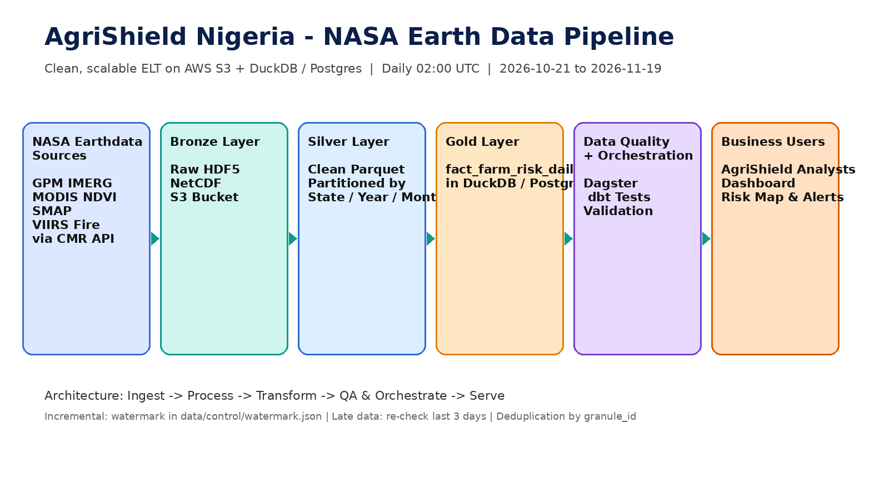

# AgriShield Nigeria — NASA Earth Data Pipeline



> Built a Bronze → Silver → Gold pipeline from NASA Earthdata for a mock crop insurer covering 50,000 farmers in 5 states / 15 LGAs.

**Data window:** 2026-10-21 to 2026-11-19 (last 30 days). Pipeline is incremental and runs daily at 02:00 UTC.

## Business Problem
AgriShield Nigeria sells crop insurance to smallholder farmers, but had no timely view of drought risk. It relied on monthly spreadsheets and field agents. Drought claims took weeks to verify. Premiums were the same for everyone, even though a farmer in Kano (dry, millet) has very different risk than a farmer in Lagos (wet, vegetables).

## Solution
Built a data engineering pipeline that turns NASA satellite data into a daily business table: `fact_farm_risk_daily`.

**NASA → Bronze (Raw) → Silver (Clean) → Gold (Star Schema) → Business**

| Layer | What it is | Format |
|---|---|---|
| **Bronze** | Exactly as NASA delivers it | HDF5 / NetCDF + manifest |
| **Silver** | Cleaned, partitioned | Parquet by `state / year / month` |
| **Gold** | Business-ready Star Schema | DuckDB / Postgres |

## Coverage — 5 States, 15 LGAs, 50,000 farmers
- **Lagos:** Ikeja, Lekki, Epe — 6,000 farmers
- **Oyo:** Ibadan North, Ogbomosho, Oyo — 14,000 farmers
- **Ogun:** Abeokuta South, Ifo, Sagamu — 11,000 farmers
- **Kano:** Kano Municipal, Dala, Gwale — 10,000 farmers
- **Kaduna:** Kaduna North, Zaria, Kafanchan — 9,000 farmers

Pipeline is partitioned by `state / year / month`, so adding the remaining 31 states + FCT requires no code change.

## NASA Datasets Used
| Dataset | NASA ID | Use |
|---|---|---|
| GPM IMERG | `GPM_3IMERGDF` | Daily rainfall (mm) |
| MODIS NDVI | `MOD13A2` | Vegetation health (-1 to 1) |
| SMAP | `SPL3SMP` | Soil moisture (0 to 1) |
| VIIRS Active Fire | `VNP14IMGT` | Fire detections |

## Star Schema
**Facts:** `fact_farm_risk_daily` (1 row per `date x state x LGA`) — `avg_rainfall_mm`, `avg_ndvi`, `avg_soil_moisture`, `drought_score (0-100)`, `fire_count` ; `fact_claims` — Insurance claims
**Dimensions:** `dim_customer` (50,000 farmers), `dim_location` (15 LGAs), `dim_date`, `dim_crop` (14 crops)

## Incremental Loading
This pipeline is incremental, not full-refresh.
- **First run:** Backfills from 2026-10-21
- **Daily run:** Only ingests new granules where `granule_date > watermark`
- **Late data:** Re-checks last 3 days every run, in case NASA delivers late
- **Deduplication:** Skips granule if manifest already exists. Unique key: `(granule_id)`
- **Watermark:** Stored in `data/control/watermark.json` as `max_ingested_date`
- **Failure safety:** Watermark only updates after successful download

## Business Impact
- **See drought daily:** "Kano Municipal drought_score = 82 today, 4,000 farmers at risk"
- **Price correctly:** High-risk LGAs pay more, low-risk pay less
- **Pay claims faster:** drought_score > 70 for 7 days = auto-review, no agent visit
- **Warn farmers:** "Low rainfall in Ogbomosho, consider irrigation this week"

## Project Structure
```
├── src/ingestion/ingest.py      # CMR API → Bronze (incremental)
├── src/transform/               # Bronze → Silver → Gold
├── dags/pipeline.py             # Daily 02:00 UTC orchestration
├── dbt/models/                  # Staging + Marts + Tests
├── sql/                         # Business queries
├── docs/architecture.png
└── data/samples/                # Small demo samples (NOT raw)
```

## How To Run
```bash
pip install -r requirements.txt
cp .env.example .env
python src/ingestion/ingest.py --dataset gpm --start 2026-10-21 --end 2026-11-19
python src/transform/bronze_to_silver.py
python src/transform/build_gold.py
dbt run
dbt test
```
To run without NASA login, use the samples in `data/samples/` — all queries in `sql/` work directly on them.

## Data Quality
dbt tests in `dbt/models/marts/farm_risk_daily.yml`:
- `date`, `state`, `lga` not null
- `rainfall_mm` 0-500
- `ndvi` -1 to 1
- `drought_score` 0-100
- Unique `(date, state, lga)`
- DAG fails if missing days > 5%

## Sample Queries
Top drought LGAs:
```sql
SELECT l.state, l.lga, COUNT(c.farmer_id) AS farmers_at_risk
FROM fact_farm_risk_daily f
JOIN dim_location l ON f.location_key = l.location_key
JOIN dim_customer c ON c.location_key = l.location_key
WHERE f.drought_score > 70 AND c.policy_status = 'Active'
GROUP BY l.state, l.lga
ORDER BY farmers_at_risk DESC;
```

## Note on Data
`data/samples/` contains small Silver extracts modelled on NASA structure for demo. Real pipeline ingests raw HDF5/NetCDF from NASA Earthdata via CMR API. Raw data is intentionally NOT committed to Git — it lives in S3 / Bronze (see `.gitignore`).

## Tech Stack
Python, earthaccess, xarray, DuckDB, Parquet, dbt, Dagster, SQL
